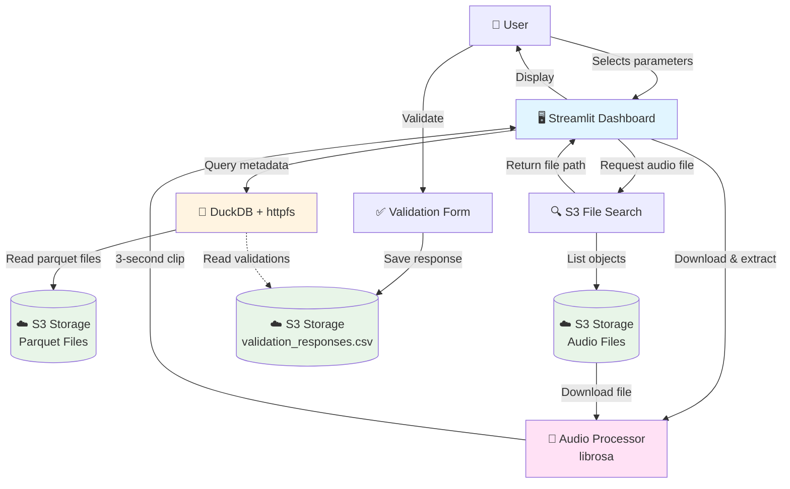

# TABMON Listening Lab

This repository contains the source code for the TABMON Listening Lab, an interactive web application designed to help users annotate acoustic data collected by the [TABMON project](https://tabmon-eu.nina.no/).

## Apps

The repository contains **two apps** that share the same code base (`src/core/`) and configuration (`src/config.py`):

### 🐦 Citizen app (`src/citizen_app.py`)
- Open access for all users
- Country → Site → Species selection, optional datetime filter
- Random clip selection from all BirdNET predictions
- Simple Yes/No/Unsure validation, saved to `validations/`

### 🎓 Expert app (`src/expert_app.py`)
- Login with an assigned user ID on a selected annotation dataset (`validation_dataset/*.parquet`)
- Detailed species checklist, vocalization types and False-Positive characterization
- Review mode to browse and cross-validate previous annotations
- Annotations saved to `validations_expert/`

### Code layout

```
src/
  config.py         shared configuration (S3, paths, audio, languages)
  core/             shared code: S3/DuckDB access, audio, spectrogram, species names, site info
  citizen/          citizen app modules
  expert/           expert app modules
  citizen_app.py    citizen app entry point
  expert_app.py     expert app entry point
```

## How it works

The TABMON Listening Lab connects to an S3 storage that hosts the audio data and the results from the AI models used to classify the bird songs. The audio data is presented to the users in the form of short audio clips (3 seconds) along with the AI model predictions. Users can listen to the audio clips and provide their annotations regarding the presence of bird species.

### Architecture



### Setup

1. Clone the repository:

```bash
git clone https://github.com/NINAnor/tabmon_species_api.git
```

2. For local Compose, copy `.env.example` to `.env` and set your S3 credentials. In Portainer, enter `S3_ENDPOINT`, `S3_ACCESS_KEY_ID`, `S3_SECRET_ACCESS_KEY`, and `S3_BUCKET` as stack environment variables instead; Compose passes them into both containers. Do not commit credentials.

3. Run both apps:

```bash
docker compose up --build -d
```

The expert app is served on port `8505` and the citizen app on port `8506`. The container runs the app selected by the `APP` environment variable (`expert` or `citizen`). To run a single app locally:

```bash
uv run streamlit run src/expert_app.py   # or src/citizen_app.py
```

> [!WARNING]
> The prediction parquet files (`PREDICTIONS_S3_PREFIX`), the expert datasets and `SITE_INFO_S3_PATH` have a very specific format and you may need to modify the code to fit your own dataset.

### Contact

For questions or contributions, please contact me at [benjamin.cretois@nina.no](mailto:benjamin.cretois@nina.no). Feel free to open issues or pull requests on the GitHub repository.
